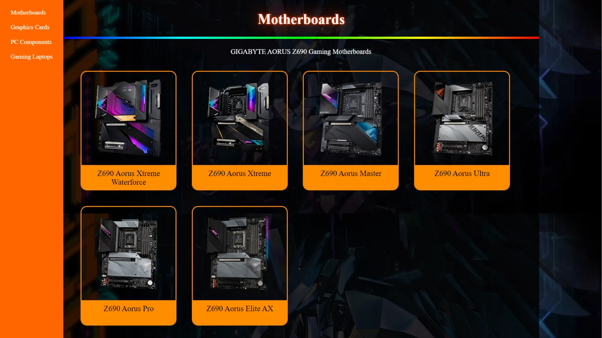
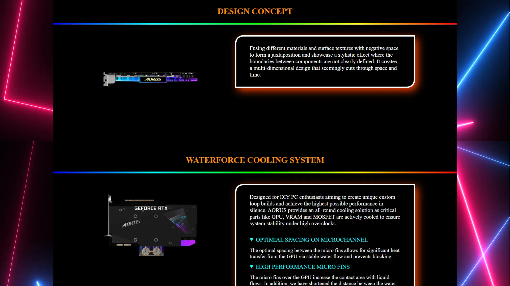

# Aorus Gaming Showcase


## Project Overview

Aorus Gaming Showcase is an interactive, high-fidelity web showroom designed to highlight flagship gaming hardware and computer components from the Aorus product line. The platform addresses the fragmentation of enthusiast computer hardware specifications by consolidating motherboards, graphics cards, gaming laptops, and PC components into a unified, visually engaging web experience. Built with pure semantic web standards, the project demonstrates that rich multimedia interfaces—featuring looping background video, live telemetry clock widgets, multi-angle image carousels, and comprehensive technical benchmark documentation—can be delivered efficiently without the bundle overhead of external frontend frameworks.

## Screenshots / Preview

### 1. Interactive Homepage & Hero Experience

The main landing interface features a fullscreen background video reel, dynamic date and time telemetry driven by vanilla JavaScript, and immediate call-to-action pathways directing enthusiasts to hardware categories and curated benchmark articles.

### 2. Product Category Catalog

A responsive overview catalog showcasing the four core Aorus hardware pillars—Motherboards, Graphics Cards, PC Components, and Gaming Laptops—styled with GPU-accelerated hover zoom transitions and clear navigational pathways.

### 3. Hardware Lineup & Sub-Product Directory

A focused hardware listing layout that presents specific product series within a chosen component family, detailing individual model designations, technical badges, and direct links to comprehensive specification sheets.

### 4. Comprehensive Product Showcase & Gallery

The flagship product detail view incorporates a custom-built vanilla JavaScript slideshow carousel, enabling visitors to cycle through multi-angle high-resolution photographs and inspect industrial aesthetic design elements.

### 5. Technical Specifications & Feature Matrix

An in-depth specification view breaking down critical hardware metrics including thermal dissipation architecture, VRM power delivery phases, display output connectivity, and RGB Fusion 2.0 lighting capabilities in a readable tabular format.

### 6. Technology Deep Dive & Benchmark Article

An editorial article view providing deep architectural explanations, Intel 12th-Gen processor motherboard benchmark results, and high-speed PCIe 5.0 and DDR5 memory compatibility analyses for enthusiast builders.

### 7. Explore Hub & Editorial Resource Center

The community and editorial hub aggregates DIY computer assembly tutorials, gaming chair ergonomics guides, seasonal hardware buyer recommendations, and official gaming partner announcements.

### 8. Brand Heritage & Corporate Identity

The corporate about page presents the core mission of the Aorus brand, detailing its falcon mascot iconography, competitive esports heritage, and design philosophy centered on empowering gamers to surpass their limits.

## Key Features

- **Cinematic Looping Video Hero**: Seamless MP4 video background integration delivering an immersive cyberpunk gaming aesthetic upon initial page load.
- **Real-Time Telemetry Clock Widget**: Lightweight vanilla JavaScript digital clock tracking continuous system time, calendar day, month, and year with zero external dependencies.
- **Zero-Dependency Slideshow Engine**: Custom DOM-based carousel supporting bidirectional cyclic image navigation for multi-perspective component inspection.
- **Hierarchical Hardware Navigation**: Structured multi-level product hierarchy navigating from top-level categories down to granular component specification sheets.
- **In-Depth Architectural Benchmarks**: Comprehensive editorial articles highlighting next-generation motherboard chipsets, PCIe 5.0 lanes, DDR5 memory, and thermal solutions.
- **Product Warranty Registration Interface**: Interactive form with input validation and tabulated client confirmation receipt generation for registered devices.
- **Fluid Viewport Scroll Controller**: Floating back-to-top interaction element with automated scroll threshold visibility detection and smooth scrolling behaviour.
- **Responsive Multi-Tier Layout**: Pure CSS Flexbox and Grid layouts optimized for fluid rendering across mobile smartphones, tablets, and desktop displays.

## Tech Stack

| Category | Technology | Purpose |
| --- | --- | --- |
| Markup | HTML5 | Semantic structure, video background integration, and accessible document layout |
| Styling | CSS3 | Custom typography, Flexbox/Grid layouts, gradient dividers, and GPU-accelerated hover animations |
| Scripting | JavaScript (ES6) | DOM manipulation, carousel slider logic, real-time clock telemetry, and smooth scroll handling |
| Server Scripting | PHP | Form submission handling, POST parameter sanitization, and tabular registration receipt generation |
| Asset Pipeline | WebP / PNG | High-resolution compressed product photography, brand logos, and UI screenshot previews |
| Video Delivery | MP4 / HTML5 Video | High-definition looping video background providing ambient motion graphics |

## Prerequisites

To view or serve the Aorus Gaming Showcase locally, ensure the following minimal environment is available:

- A modern standards-compliant web browser (Google Chrome, Mozilla Firefox, Microsoft Edge, or Safari).
- *(Optional for static viewing)* Any local static HTTP server such as Python 3 (`python -m http.server`) or Node.js (`npx serve`).
- *(Optional for product registration form)* PHP 7.4+ or 8.x local development environment (e.g., PHP CLI Server, XAMPP, or Laragon) to execute `Product Registration.php`.

## Installation & Setup

1. Clone the repository to your local workstation:
   ```bash
   git clone https://github.com/weztcy/Aorus-Gaming-Showcase.git
   ```

2. Navigate into the project root directory:
   ```bash
   cd "Aorus Gaming Showcase"
   ```

3. Verify project files and media asset directory integrity:
   ```bash
   dir
   ```

## Usage

The application can be launched directly in a web browser for static exploration, or hosted via a local development server for full functionality including PHP form processing.

1. **Option A: Static Exploration (Instant Browser Preview)**
   Open `index.html` directly using your preferred browser:
   ```bash
   # On Windows
   start index.html
   ```

2. **Option B: Local HTTP Server (Recommended)**
   Launch a lightweight HTTP server using Python:
   ```bash
   python -m http.server 8000
   ```
   Open your browser and navigate to `http://localhost:8000`.

3. **Option C: Full PHP Server (Enables Product Registration Form)**
   Run the built-in PHP development server from the repository root:
   ```bash
   php -S localhost:8080
   ```
   Access the website at `http://localhost:8080` and test the registration workflow at `http://localhost:8080/mainpage/Product%20Registration.php`.

## Build & Deployment

Because this project is built using native web standards, it does not require complex transpilation, bundling, or minification pipelines.

1. **GitHub Pages Deployment**:
   - Push the codebase to the `main` branch of your GitHub repository.
   - In GitHub repository settings, navigate to **Pages**.
   - Under **Build and deployment**, select `Deploy from a branch` and set the source branch to `main` with root `/ (root)`.
   - Save the configuration; GitHub Pages will publish the static site automatically.

2. **Production Web Hosting (Nginx / Apache)**:
   - Copy all repository directories (`mainpage`, `products`, `detail products`, `article`, `gallery`, `screenshot`, `script`, `service`, `index.html`) to the web server root (e.g., `/var/www/html/` or `public_html/`).
   - Ensure the web server is configured to serve standard MIME types for `.webp`, `.mp4`, `.js`, and `.css`.

## Contributing

Contributions, feedback, and hardware profile updates are welcome. To contribute:

1. Fork the repository.
2. Create a branch for the change:
   ```bash
   git checkout -b feature/hardware-update
   ```
3. Make and test the changes across multiple browser viewports.
4. Commit and push the branch:
   ```bash
   git commit -m "feat: add next-generation hardware specifications"
   git push origin feature/hardware-update
   ```
5. Open a pull request with a clear explanation of your modifications.

## License

This project is licensed under the MIT License.
See the [LICENSE](LICENSE) file for details.

## Author & Contact

**Yohanes Dimas Pratama**

- GitHub: [github.com/weztcy](https://github.com/weztcy)
- Portfolio: [yohanesdimas.com](https://yohanesdimas.com)
- LinkedIn: [linkedin.com/in/yohanes-dimas](https://www.linkedin.com/in/yohanes-dimas)
