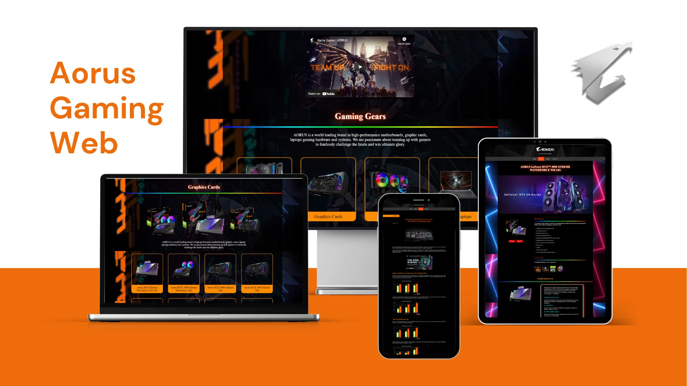

# Aorus Gaming Showcase




## Project Overview

Aorus Gaming Showcase is an interactive, multi-page web application engineered to showcase high-performance AORUS gaming hardware, flagship components, and technical benchmarks. The project delivers an immersive digital showroom experience designed for PC gamers, hardware enthusiasts, and system builders by pairing rich multimedia presentation with comprehensive engineering specifications.

## Screenshots / Preview

### 1. Home Page & Hero Showcase

The primary landing experience featuring dynamic video background integration, a real-time digital clock widget, quick navigation links, and an interactive gaming gears showcase.

### 2. Product Catalog Directory

The high-level product navigation hub categorizing hardware lines into Motherboards, Graphics Cards, PC Components, and Gaming Laptops with responsive zoom-on-hover interaction cards.

### 3. Hardware Category Lineup

Dedicated hardware category listing displaying flagship models with visual thumbnails, direct specification links, and quick-access product series navigation.

### 4. Interactive Product Detail & Carousel

Detailed product showcase presenting an interactive JavaScript-powered image gallery carousel with previous and next controls alongside key performance highlights.

### 5. In-Depth Technical Specifications

Comprehensive technical specifications table breaking down processor socket support, memory architecture, expansion slots, thermal design, and connectivity standards.

### 6. Hardware Benchmarks & Editorial Article

Tech article reading layout showcasing real-world hardware benchmark data, performance comparisons, and deep architectural analysis for high-end components.

### 7. Explore #AORUS Knowledge Hub

Content discovery section featuring curated PC building inspiration, DIY tutorials, competitive gaming insights, and global community event highlights.

### 8. Brand Philosophy & Corporate Profile

Brand overview page conveying AORUS gaming legacy, company vision, global service links, customer support resources, and unified social media channels.

## Key Features

- **Immersive Video Hero**: High-energy looping background video showcasing futuristic gaming aesthetics.
- **Real-Time Digital Clock**: Client-side JavaScript widget providing synchronized date, time, and day tracking.
- **Categorized Hardware Showcase**: Structured directory covering Motherboards, Graphics Cards, Laptops, and PC Components.
- **Interactive Multi-Image Carousel**: Custom slide-show module with responsive navigation controls for multi-angle product inspection.
- **Comprehensive Tech Specs**: Exhaustive technical parameter tables covering chipset, memory clock, cooling, and form factors.
- **Technical Articles & Benchmarks**: Rich editorial guides and hardware benchmarks covering Intel 12th-Gen performance, DDR5, and PCIe 5.0 architectures.
- **Product Registration Module**: Form interface with PHP server-side form submission and tabular confirmation rendering.
- **Smooth Navigation & Scroll Control**: Automated scroll-to-top floating action button with dynamic scroll threshold detection.

## Tech Stack

| Category | Technology | Purpose |
| --- | --- | --- |
| Markup | HTML5 | Semantic structure and multimedia embedding across showcase pages |
| Styling | CSS3 | Responsive layouts, CSS grid/flexbox, hover transitions, and dark gaming theme |
| Scripting | JavaScript (ES6) | Real-time digital clock, smooth scroll handlers, and carousel mechanics |
| Server Processing | PHP | Form payload handling and tabular confirmation for product warranty registration |
| Media Integration | YouTube Embed API | High-definition product video streaming and promotional showcases |
| Asset Delivery | WebP / PNG / MP4 | High-fidelity hardware photography and looping background video media |

## Prerequisites

- Modern Web Browser (Google Chrome, Mozilla Firefox, Microsoft Edge, or Safari)
- Local HTTP Server (Python `http.server`, Node.js `http-server`, or VS Code Live Server extension)
- PHP Runtime (optional, required only for testing `Product Registration.php` form submission)

## Installation & Setup

1. Clone the repository to your local environment:
   ```bash
   git clone https://github.com/weztcy/Aorus-Gaming-Showcase.git
   cd "Aorus Gaming Showcase"
   ```

2. Start a local development HTTP server:
   Using Python:
   ```bash
   python -m http.server 8000
   ```
   Or using Node.js:
   ```bash
   npx serve .
   ```
   Or using PHP built-in server (enables product registration form):
   ```bash
   php -S localhost:8000
   ```

3. Open your web browser and navigate to:
   ```
   http://localhost:8000
   ```

## Usage

The showcase can be browsed as a static web application directly or served through any local web server.

1. **Explore Hardware Catalog**:
   Access `index.html` to enter the main showcase. Navigate through the header menu to browse product categories or click on featured hardware cards to inspect specific lines.

2. **Interact with Image Galleries**:
   On product detail pages (such as `detail products/Gaming Laptops/AORUS 15 (Intel 12th Gen).html`), click **Prev** or **Next** buttons to cycle through hardware angles.

3. **Read Articles & Benchmarks**:
   Navigate to the **Explore** section to read hardware analysis, thermal benchmarks, and gaming setup recommendations.

4. **Test Product Registration Form**:
   When running via the PHP development server (`php -S localhost:8000`), navigate to `mainpage/Product Registration.php`, fill in the product parameters, and submit to verify registration output.

## Build & Deployment

As a client-centric web showcase, the application does not require a complex compilation pipeline and can be deployed to any static web hosting platform such as GitHub Pages, Vercel, or Netlify.

1. Ensure all asset paths and relative links are verified.
2. Deploy directly via GitHub Pages:
   - Push repository to GitHub.
   - Go to **Repository Settings** > **Pages**.
   - Under **Build and deployment**, select `Deploy from a branch` and choose the `main` branch root (`/`).
   - Save changes; your showcase will be live at `https://<username>.github.io/<repo-name>/`.

## Contributing

Contributions, suggestions, and feedback are welcome to enhance the showcase.

1. Fork the repository.
2. Create a feature branch:
   ```bash
   git checkout -b feature/showcase-enhancement
   ```
3. Commit your changes:
   ```bash
   git commit -m "Add new hardware specification sheets"
   ```
4. Push to the branch:
   ```bash
   git push origin feature/showcase-enhancement
   ```
5. Open a Pull Request detailing your changes and visual improvements.

## License

This project is licensed under the MIT License.
See the [LICENSE](LICENSE) file for details.

## Author & Contact

**Yohanes Dimas Pratama**

- GitHub: [github.com/weztcy](https://github.com/weztcy)
- Portfolio: [yohanesdimas.com](https://yohanesdimas.com)
- LinkedIn: [linkedin.com/in/yohanes-dimas](https://www.linkedin.com/in/yohanes-dimas)
