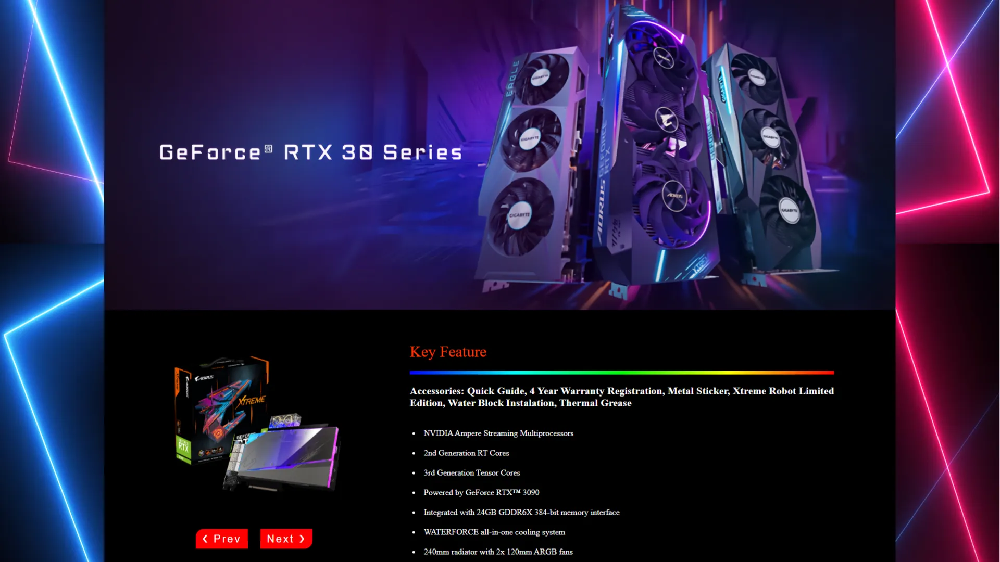
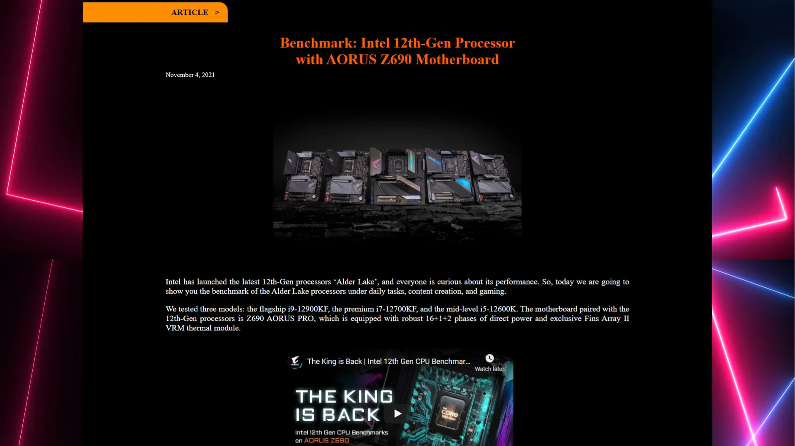

# Aorus Gaming Showcase


## Project Overview

Aorus Gaming Showcase is an interactive, multi-page client-side web application designed to showcase premium gaming hardware from the GIGABYTE AORUS ecosystem. The portal centralizes fragmented product technical specifications across motherboards, graphics cards, PC components, and gaming laptops into a unified, visually engaging presentation layer. By blending immersive ambient video backgrounds, rich multimedia integration, granular technical data sheets, and dedicated hardware benchmark publications, the application delivers a seamless digital catalog and discovery experience tailored for PC gamers, hardware enthusiasts, and system builders.

## Screenshots / Preview

### 1. Home Page & Interactive Hero Showcase

The primary landing view integrates a looping background video, an official AORUS showcase video player, a real-time JavaScript digital clock, and responsive navigation cards directing users to the four core hardware categories.

### 2. Motherboards Product Catalog

The dedicated motherboard catalog interface presents the flagship GIGABYTE AORUS Z690 lineup engineered for 12th-Gen Intel processors, featuring hover-zoom card micro-interactions for Z690 Xtreme Waterforce, Master, Ultra, Pro, and Elite AX models.

### 3. Graphics Cards Lineup Showcase

The graphics card portal exhibits the high-performance AORUS GeForce RTX 30 Series GPUs, displaying air-cooled and liquid-cooled Waterforce models within a responsive grid layout linked directly to in-depth technical specifications.

### 4. Product Detail & Interactive Image Carousel

The comprehensive product detail page for the AORUS GeForce RTX 3090 XTREME WATERFORCE WB 24G incorporates a custom vanilla JavaScript slideshow carousel with Prev/Next controls, accessory inventories, and architecture clocks.

### 5. Architectural Engineering & Cooling Innovations

A specialized technical deep-dive view detailing the geometric design ethos and Waterforce liquid cooling architecture, highlighting microchannel spacing, micro-fin surface contact, and extreme thermal dissipation design.

### 6. Hardware Benchmark & Technical Article

An in-depth hardware engineering publication examining Intel 12th-Gen Alder Lake processors paired with the AORUS Z690 PRO motherboard, structured with multi-tier thermal analysis, benchmark comparisons, and embedded video demonstration.

### 7. Explore & Community DIY Hub

The community content aggregation portal compiling DIY PC building walkthroughs, peripheral setup guides such as the Gaming Chair Beginners 101 guide, and global esports tournament event updates.

### 8. Brand Identity & Vision Portal

The brand heritage portal presenting the "Enter the Falcon" origin narrative, the "Team Up. Fight On." gaming motto, embedded cinematic video showcases, and AORUS's engineering commitment to competitive esports hardware.

## Key Features

- **Categorized Multi-Page Product Catalog**: Comprehensive catalog navigation spanning Motherboards, Graphics Cards, PC Components, and Gaming Laptops across dedicated interfaces.
- **Granular Hardware Detail Specifications**: Over 20+ individual product views with detailed technical datasheets, component dimensions, and bundled accessory lists.
- **Interactive Multimedia & Ambient Video**: Fullscreen looping background video (`PUNK GAMING.mp4`) with aspect-ratio responsive handling and embedded YouTube multimedia players.
- **Vanilla JavaScript Interactive Controls**: Real-time 12-hour/24-hour synchronized digital clock, automated and manual image slideshow carousel, and smooth back-to-top floating scroll controls.
- **Hardware Benchmarks & Editorial Hub**: Curated technical article archive examining Intel 12th-Gen processor benchmarks on Z690 chipsets, PCIe 5.0 / DDR5 architectural transitions, and DIY setup guides.
- **Responsive Multi-Viewport Layout**: Pure CSS flexbox and grid styling with smooth hover transitions, glow micro-interactions, and mobile viewport optimizations.
- **Server-Side Product Registration Module**: Integrated PHP form processing endpoint for hardware warranty validation and purchase record submissions.

## Tech Stack

| Category | Technology | Purpose |
| --- | --- | --- |
| Markup | HTML5 | Semantic structure and multimedia embedding across 40+ pages |
| Styling | CSS3 | Responsive layouts, CSS Flexbox/Grid, keyframe animations, and dark cyberpunk aesthetic |
| Client-Side Scripting | JavaScript (ES6) | Real-time digital clock, interactive carousel controls, and scroll behavior |
| Server-Side Scripting | PHP | Product warranty and registration form submission handling |
| Multimedia Assets | WebP / MP4 / PNG | Optimized WebP screenshots, ambient background videos, and official high-resolution brand assets |
| Local Development | Live Server | Lightweight local development server with live browser reloading |
| Version Control | Git / GitHub | Distributed source code management and repository hosting |

## Prerequisites

Before running the project locally, ensure you have the following installed:

- A modern web browser (Google Chrome, Mozilla Firefox, Microsoft Edge, or Safari).
- A local HTTP server utility (such as the VS Code Live Server extension, Python 3 `http.server`, or Node.js `serve`).
- *(Optional)* PHP 7.4+ or 8.x (only required if testing the server-side form submission in `mainpage/Product Registration.php`).

## Installation & Setup

1. Clone the repository from GitHub:

   ```bash
   git clone https://github.com/weztcy/Aorus-Gaming-Showcase.git
   ```

2. Navigate into the project root directory:

   ```bash
   cd "Aorus Gaming Showcase"
   ```

3. Launch a local web server to serve static assets and video files:

   - **Using Python 3**:

     ```bash
     python -m http.server 8000
     ```

   - **Using Node.js (`npx serve`)**:

     ```bash
     npx serve .
     ```

   - **Using VS Code Live Server**:
     Right-click `index.html` in the file explorer and select **Open with Live Server**.

4. *(Optional)* If executing the PHP registration module, run the built-in PHP development server:

   ```bash
   php -S localhost:8000
   ```

## Usage

1. Open your web browser and navigate to the local server address (e.g., `http://localhost:8000`).
2. Explore the home landing page to view the ambient video background, real-time clock, and quick navigation cards.
3. Access the **Product** tab from the top navigation bar to browse hardware categories (Motherboards, Graphics Cards, PC Components, Gaming Laptops) or use side anchor links to jump directly to category sections.
4. Click on any product item card to open its dedicated detail page, where you can cycle through product gallery angles using the interactive slideshow carousel.
5. Browse the **Explore** section to read hardware benchmark analyses and DIY gaming tutorials.
6. Test product registration by navigating to `mainpage/Product Registration.php`, completing the registration form fields, and submitting to view the echoed registration confirmation summary.

## Contributing

Contributions are welcome to expand hardware documentation, improve accessibility, or enhance responsive styling. To contribute:

1. Fork the repository.
2. Create a branch for the change (`git checkout -b feature/improvement`).
3. Make and test the changes across multiple viewport sizes.
4. Commit and push the branch (`git push origin feature/improvement`).
5. Open a pull request with a clear explanation of changes made.

## License

This project is licensed under the MIT License.
See the [LICENSE](LICENSE) file for details.

## Author & Contact

**Yohanes Dimas Pratama**

- GitHub: [github.com/weztcy](https://github.com/weztcy)
- Portfolio: [yohanesdimas.com](https://yohanesdimas.com)
- LinkedIn: [linkedin.com/in/yohanes-dimas](https://www.linkedin.com/in/yohanes-dimas)
