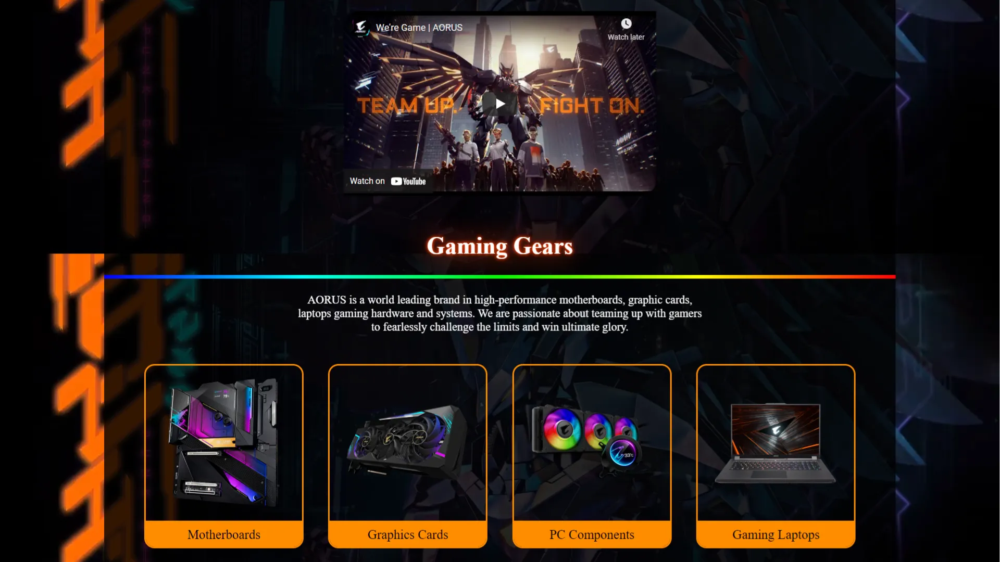
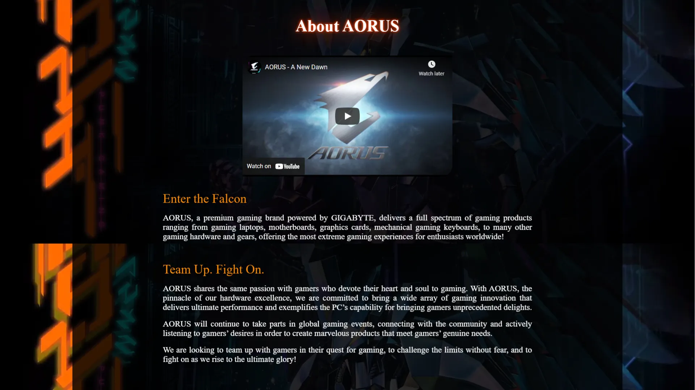

# Aorus Gaming Showcase


## Project Overview

Aorus Gaming Showcase is an interactive multimedia web portal engineered to exhibit high-performance enthusiast PC hardware and gaming peripherals from the AORUS ecosystem. The platform serves as an immersive digital product catalog and technical media hub that bridges the gap between hardware enthusiasts and product specifications. By integrating dynamic video backgrounds, custom client-side carousel galleries, real-time telemetry clocks, and curated DIY benchmark publications, the project delivers an engaging, structured showcase of motherboards, graphics cards, PC components, and gaming laptops.

## Screenshots / Preview






## Key Features

- Interactive multi-angle image carousel on product detail pages with custom previous and next controls.
- Dynamic digital clock component calculating real-time date, month, year, and 12-hour AM/PM telemetry.
- Smooth floating back-to-top navigation button with automated scroll threshold detection.
- High-definition ambient video background integration creating an immersive cyberpunk gaming aesthetic.
- Categorized hardware directories covering Motherboards, Graphics Cards, PC Components, and Gaming Laptops.
- Curated DIY tech article hub presenting benchmarks, build recommendations, and connectivity guides.
- Simulated product registration portal supporting form submission and instantaneous tabulated confirmation.

## Tech Stack

| Category | Technology | Purpose |
| --- | --- | --- |
| Markup | HTML5 | Semantic structure, navigation hierarchy, and multimedia video embedding |
| Styling | CSS3 | Responsive layouts, CSS Flexbox grids, transitions, and hover zoom effects |
| Scripting | JavaScript (ES6) | Client-side DOM manipulation, slideshow logic, and real-time clock rendering |
| Server-Side | PHP | Form input processing and dynamic tabular confirmation rendering |
| Tooling | Live Server | Local development server with instant reload functionality |

## Prerequisites

- Modern web browser (Google Chrome, Mozilla Firefox, Microsoft Edge, or Safari)
- Local HTTP server utility (VS Code Live Server extension, Python `http.server`, or Node.js `http-server`)
- PHP runtime (version 7.4 or higher) for executing the product registration form (`Product Registration.php`)

## Installation & Setup

1. Clone the repository from GitHub:
   ```bash
   git clone https://github.com/weztcy/Aorus-Gaming-Showcase.git
   cd Aorus-Gaming-Showcase
   ```

2. Verify project assets and folder structure:
   ```bash
   dir
   ```

3. Launch a local development server for client-side browsing:
   ```bash
   # Using Python 3 built-in HTTP server
   python -m http.server 8000

   # Or using Node.js npx
   npx http-server -p 8000
   ```

4. Alternatively, launch a PHP development server to enable full form submission processing:
   ```bash
   php -S localhost:8000
   ```

## Usage

Access the application through any modern browser to explore the hardware catalog and interactive components.

1. Open `http://localhost:8000` in your web browser to enter the main landing page.
2. Navigate between hardware categories using the top navigation bar or the featured category cards.
3. Select any hardware product card to inspect multi-angle gallery photos, technical highlights, and specification tables.
4. Browse the Explore section to read comprehensive hardware benchmark articles and DIY PC building tips.
5. Navigate to `mainpage/Product Registration.php` to test the simulated warranty registration form and view the generated confirmation table.

## Contributing

Contributions, bug reports, and suggestions are welcome to help improve the project.

1. Fork the repository.
2. Create a feature branch for your changes (`git checkout -b feature/enhanced-showcase`).
3. Make and verify your modifications across supported desktop resolutions.
4. Commit and push your changes (`git push origin feature/enhanced-showcase`).
5. Open a pull request with a concise description of your implementation.

## License

This project is licensed under the MIT License.
See the [LICENSE](LICENSE) file for details.

## Author & Contact

**Yohanes Dimas Pratama**

- GitHub: [github.com/weztcy](https://github.com/weztcy)
- Portfolio: [yohanesdimas.com](https://yohanesdimas.com)
- LinkedIn: [linkedin.com/in/yohanes-dimas](https://www.linkedin.com/in/yohanes-dimas)
