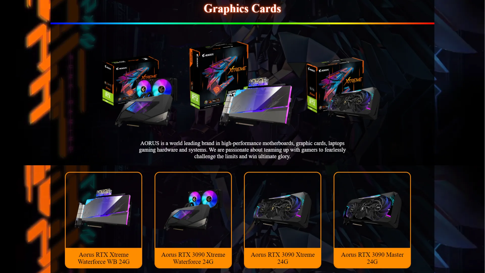
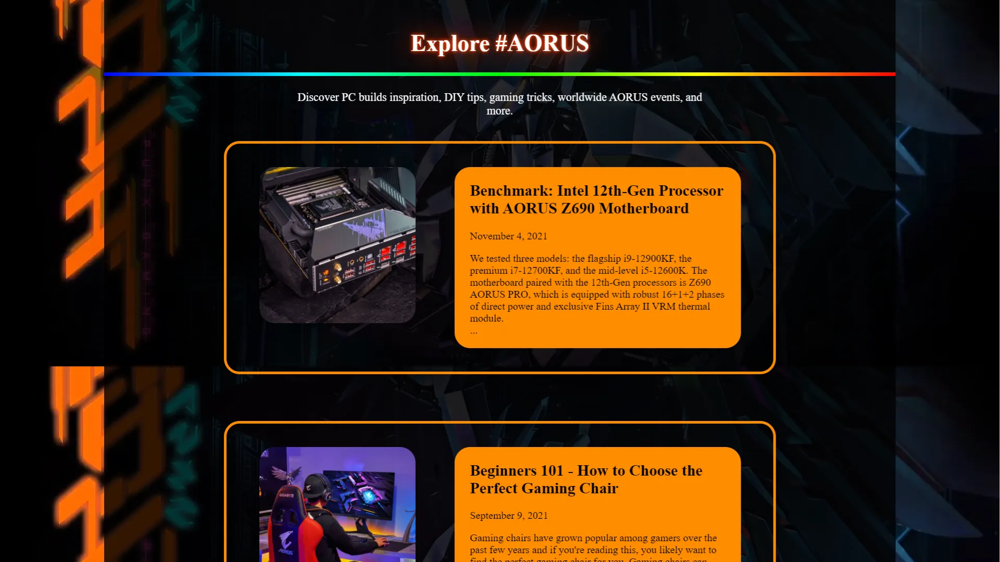

# Aorus Gaming Showcase


## Project Overview

Aorus Gaming Showcase is an interactive, high-fidelity web platform engineered to present the premium lineup of GIGABYTE AORUS gaming hardware and PC gaming systems. Designed to solve the issue of fragmented and unengaging product specifications across traditional retail channels, the application unifies flagship hardware categories—including Z690 motherboards, GeForce RTX 30 Series graphics cards, liquid cooling solutions, and high-performance gaming laptops—into an immersive, cyberpunk-inspired digital experience. Through multi-angle component image carousels, comprehensive technical specifications, curated hardware benchmark reviews, and an integrated warranty product registration interface, the platform delivers an engaging visual journey tailored for hardware enthusiasts, PC builders, and competitive gamers.

## Key Features

- **Categorized Hardware Showcase**: Structured product galleries covering flagship motherboards, GeForce RTX 30 series graphics cards, liquid coolers, power supplies, and gaming laptops.
- **Interactive Multi-Angle Gallery Slider**: Custom native JavaScript image slider allowing users to inspect gaming components from multiple angles with indexed controls.
- **Real-Time Dynamic Clock**: Client-side date and time calculation engine displaying live synchronized time with zero-padded formatting.
- **Sticky Category Navigation**: Fixed sidebar navigation facilitating quick jumps between hardware categories without losing scroll context.
- **Explore Editorial & Benchmark Hub**: Curated technical editorial section featuring real-world Intel 12th-Gen Core processor benchmarks, DDR5/PCIe 5.0 architecture analysis, and DIY building guides.
- **Product Warranty Registration Portal**: Form interface allowing gamers to submit product types, models, serial numbers, and purchase regions with dynamic confirmation feedback.
- **Smooth Viewport Navigation**: Floating 'Back to Top' navigation button automatically triggered upon scroll threshold for seamless page traversal.
- **Embedded Multimedia Streaming**: Native integration of promotional brand video reels and YouTube hardware demonstrations.

## Tech Stack

| Category | Technology | Purpose |
| --- | --- | --- |
| Markup | HTML5 | Semantic structure for product listings, multimedia containers, and navigation layouts |
| Styling | CSS3 | Responsive Flexbox/Grid layouts, cyberpunk dark-theme aesthetics, and CSS animations |
| Scripting | JavaScript (ES6) | Client-side DOM manipulation, interactive slideshow controller, and live clock engine |
| Server Scripting | PHP | Form POST handling and dynamic submission confirmation for warranty registration |
| Tooling | Live Server | Local development hot-reload server environment for synchronized browser testing |
| Media Delivery | WebP / MP4 | High-efficiency compressed visual assets and background ambient video streams |

## Screenshots / Preview

### 1. Landing Page & Hero Section

The homepage hero section introduces visitors to the AORUS gaming ecosystem, featuring an embedded official brand video reel, a live digital clock, and quick-access navigation cards to primary gaming gear categories.

### 2. Motherboard Catalog & Sticky Category Navigation

The motherboard catalog view showcases the full GIGABYTE AORUS Z690 gaming lineup, featuring a sticky sidebar for seamless category switching, responsive card layouts, and direct links to comprehensive specification sheets.

### 3. Graphics Cards Lineup Showcase

The dedicated graphics cards section highlights flagship GeForce RTX 30 Series GPUs, displaying retail packaging aesthetics, cooling configurations, and interactive hover transitions for PC enthusiasts.

### 4. Product Detail View & Interactive Image Slider

The product detail view for the GeForce RTX 3090 XTREME WATERFORCE WB 24G provides an interactive client-side image slider, enabling users to view the hardware from multiple angles alongside key architectural specifications.

### 5. Thermal Architecture & Waterforce Cooling Breakdown

An in-depth engineering breakdown section illustrating the advanced thermal dynamics of the Waterforce cooling system, detailing microchannel spacing and liquid heat dissipation designed for extreme overclocking stability.

### 6. Hardware Benchmarks & Review Editorial

The editorial benchmark view presents comparative performance metrics of Intel 12th-Gen Alder Lake processors paired with AORUS Z690 motherboards across everyday computing, content creation, and high-frame-rate gaming.

### 7. Explore Portal & Hardware Insights

The Explore hub curates community articles, DIY PC building guides, and gaming tips, giving gamers actionable advice on choosing gaming chairs, optimizing high-speed DDR5 memory, and configuring display interfaces.

### 8. About AORUS Brand Heritage & Falcon Philosophy

The brand heritage view highlights the AORUS 'Enter the Falcon' identity, communicating corporate values, competitive gaming heritage, global event engagements, and embedded official media productions.

## Prerequisites

- Modern Web Browser (Google Chrome 90+, Mozilla Firefox 88+, Microsoft Edge 90+, or Safari 14+)
- Local Web Server (VS Code Live Server extension, Python `http.server`, or Node.js `serve` / `http-server`)
- Optional for PHP Form Processing: Local PHP runtime (PHP 7.4+ or 8.x) or web server bundle (XAMPP, WampServer, or Laragon)

## Installation & Setup

1. Clone or download the repository to your local workspace:
   ```bash
   git clone https://github.com/weztcy/aorus-gaming-showcase.git
   cd aorus-gaming-showcase
   ```

2. Verify project assets and structure:
   ```bash
   dir
   ```

3. Launch a local web development server:
   - Using Node.js `npx serve`:
     ```bash
     npx serve .
     ```
   - Or using Python built-in HTTP server:
     ```bash
     python -m http.server 8080
     ```
   - Or using PHP built-in server (to enable full form registration handling):
     ```bash
     php -S localhost:8000
     ```

## Usage

Aorus Gaming Showcase can be accessed locally via any standard modern browser without requiring build compilation steps.

1. Open your web browser and navigate to the local server address:
   ```text
   http://localhost:8000
   ```
2. Interact with the primary features:
   - Browse the **Home** portal to observe live clock synchronization and brand multimedia.
   - Click **Product** in the top navigation bar to explore hardware categories using the left sticky anchor menu.
   - Select individual hardware cards (e.g. Z690 Aorus Xtreme Waterforce or RTX 3090 Xtreme) to open detail pages with multi-angle slider controls.
   - Visit **Explore** to review benchmarking articles and hardware guides.
   - Access **Product Registration** under `mainpage/Product Registration.php` to test warranty registration inputs and dynamic POST feedback.

## Build & Deployment

1. **Static Web Hosting (GitHub Pages, Vercel, Netlify)**:
   Deploy the static frontend by pointing the web root to the project directory:
   ```bash
   npx vercel --prod
   ```
   For GitHub Pages, enable Pages deployment from the repository's `main` branch.

2. **Full-Stack Deployment with PHP Support**:
   Deploy the project folder to an Apache/Nginx web server with PHP enabled (such as cPanel, shared hosting, or Dockerized LAMP/LEMP container):
   ```bash
   docker run -d -p 80:80 -v "$PWD":/var/www/html php:8.1-apache
   ```

## Contributing

Contributions, issues, and feature suggestions are welcome. Please follow the standard contribution workflow:

1. Fork the repository.
2. Create a branch for the change (`git checkout -b feature/enhancement-name`).
3. Make and test the changes across different browser viewports.
4. Commit and push the branch (`git commit -m "Add responsive layout improvement"`).
5. Open a pull request with a clear explanation of your improvements.

## License

This project is licensed under the MIT.
See the [LICENSE](LICENSE) file for details.

## Author & Contact

**Yohanes Dimas Pratama**

- GitHub: [github.com/weztcy](https://github.com/weztcy)
- Portfolio: [yohanesdimas.com](https://yohanesdimas.com)
- LinkedIn: [linkedin.com/in/yohanes-dimas](https://www.linkedin.com/in/yohanes-dimas)
