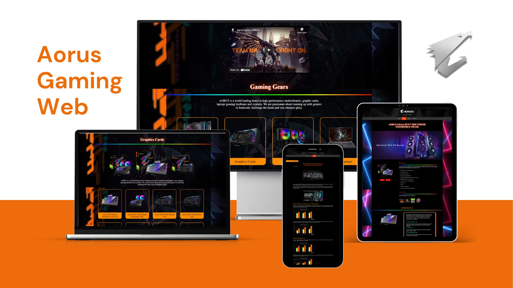
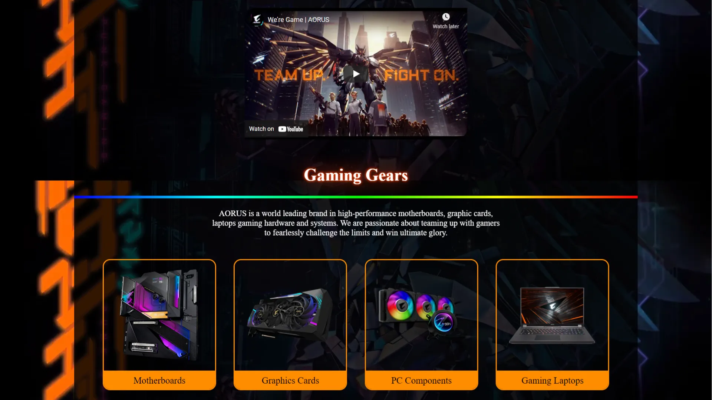
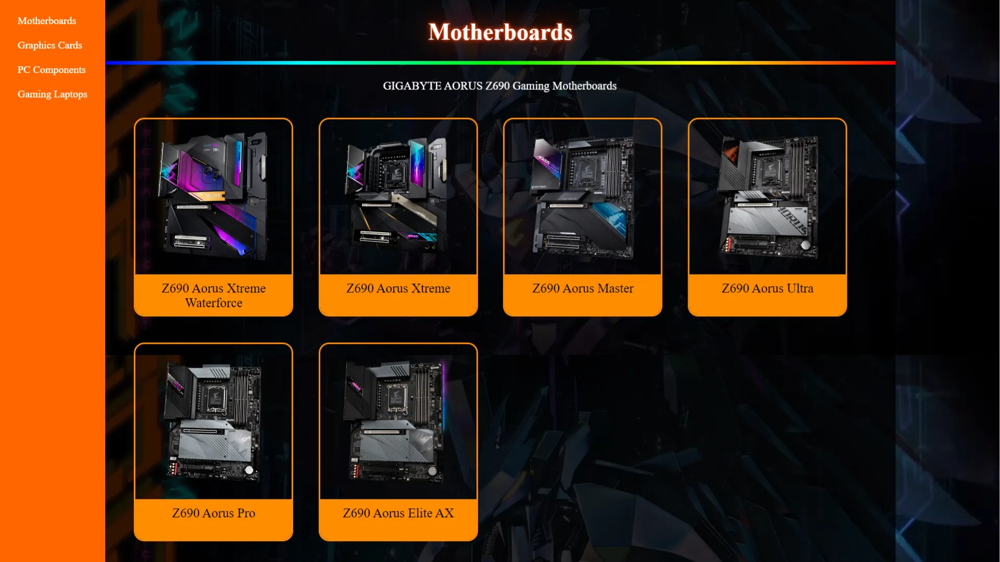
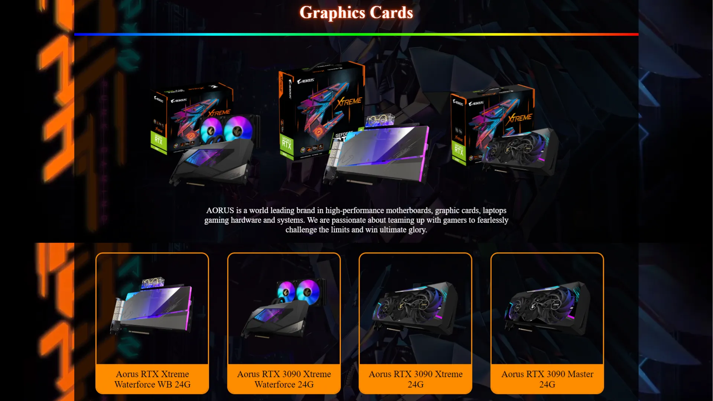
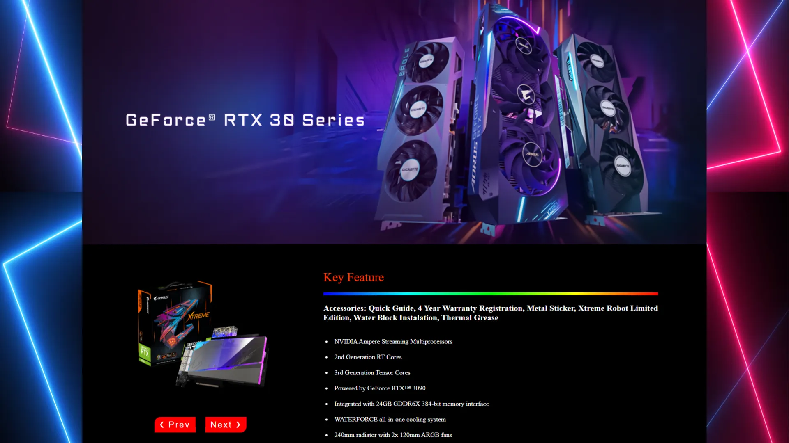
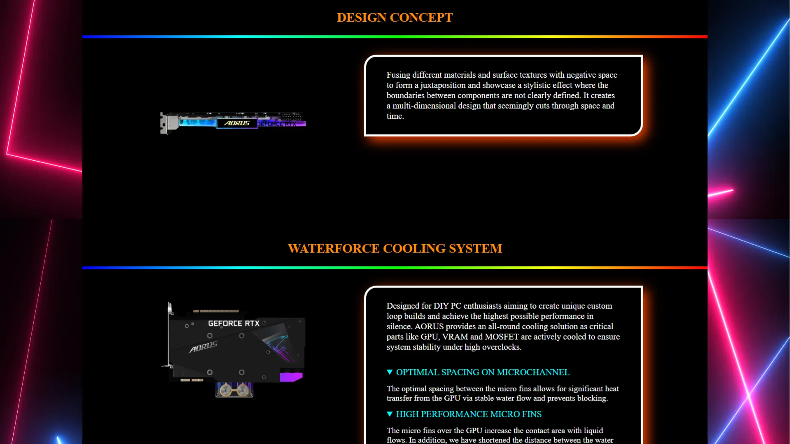
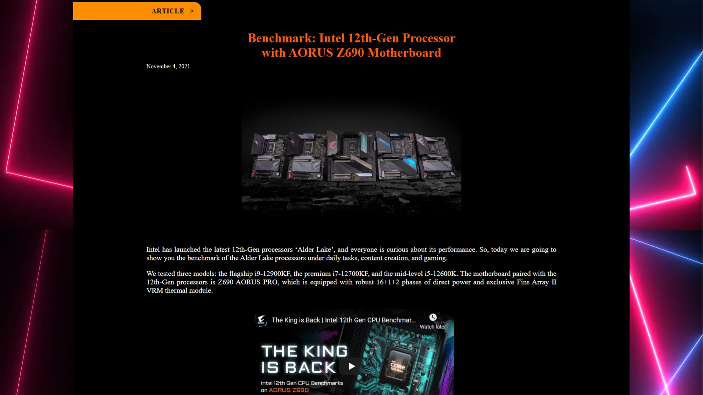
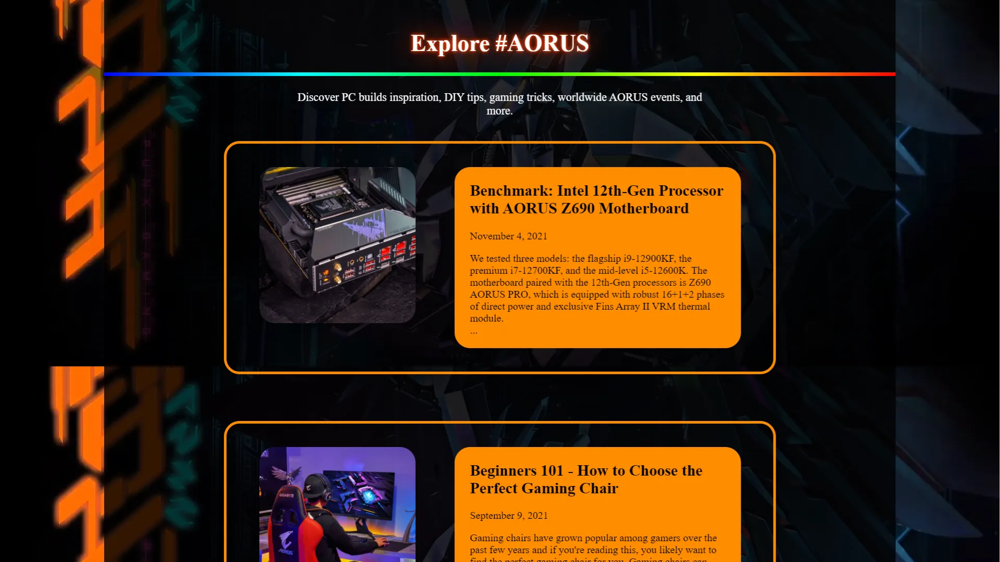
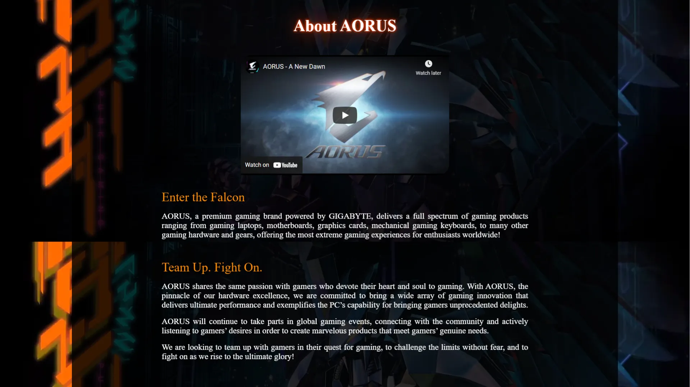

# Aorus Gaming Showcase




## Project Overview

Aorus Gaming Showcase is a responsive multi-page web application designed as a comprehensive hardware showcase and editorial portal for GIGABYTE AORUS gaming products. It organizes 22 individual hardware specification pages across four product lines—Motherboards, Graphics Cards, PC Components, and Gaming Laptops—alongside seven technical editorial articles under the Explore #AORUS hub. The project addresses the need for an immersive, visually unified product discovery experience by combining looping ambient video backgrounds, custom CSS3 animations, interactive JavaScript widgets, and a PHP-based product registration workflow.

## Key Features

- **Multi-Category Product Catalog**: Features a unified catalog (`mainpage/product.html`) with a sticky section-jump sidebar alongside four dedicated category landing pages (`products/motherboards.html`, `products/graphics cards.html`, `products/pc components.html`, and `products/gaming laptops.html`).
- **22 Detailed Hardware Specification Pages**: Provides dedicated detail pages for 6 Z690 AORUS motherboards, 8 GeForce RTX 30 series graphics cards, 5 PC components (chassis, PSU, liquid cooler, SSD, RAM), and 3 Intel 12th-Gen AORUS gaming laptops.
- **Interactive Product Image Slideshow**: Implements client-side JavaScript gallery controls (`script/Slide Show.js`) with `Prev` and `Next` navigation buttons on product detail pages.
- **Editorial Hub (`Explore #AORUS`)**: Hosts 7 formatted technical articles and buyer guides covering Intel 12th-Gen benchmarks, DDR5 and PCIe 5.0 technology, VisionLINK connectivity, creator laptops, gaming chairs, and hardware bundles.
- **Live Digital Clock & Scroll Navigation**: Includes a real-time date and 12-hour clock widget (`script/Digital Clock.js`) on the home page and a threshold-triggered back-to-top button (`script/Back To Top.js`) across all pages.
- **Ambient Multimedia Integration**: Embeds looping HTML5 background MP4 videos (`PUNK GAMING.mp4` and `Neon Lights Ran In Polygons.mp4`) and responsive YouTube brand/benchmark video players.
- **Responsive Multi-Device Styling**: Uses modular CSS3 Flexbox layouts, custom keyframe glow/glitch animations (`lightson`, `glitch`), and media queries at `1200px`, `992px`, `768px`, and `480px` breakpoints.
- **Product Registration Form Handler**: Includes a PHP form endpoint (`mainpage/Product Registration.php`) that captures product type, name, serial number, purchase date, and region via HTTP `POST` and renders a registration confirmation table.

## Tech Stack

| Category | Technology | Purpose |
| --- | --- | --- |
| Markup | HTML5 | Semantic multi-page structure for home, catalog, product details, articles, and brand pages |
| Styling | CSS3 | Modular page stylesheets featuring Flexbox grids, keyframe animations, gradients, and responsive media queries |
| Client Scripting | Vanilla JavaScript | Interactive product image slideshows, real-time digital clock display, and scroll-triggered back-to-top navigation |
| Server Scripting | PHP | Server-side `POST` form processing and confirmation table rendering in `Product Registration.php` |
| Multimedia | HTML5 Video & YouTube Embeds | Full-bleed looping MP4 background video playback and embedded brand showcase and benchmark videos |

## Screenshots / Preview

### 1. Home Page & Gaming Gears Overview

The main landing portal displays the embedded AORUS brand showcase video above the "Gaming Gears" category grid. Users can jump directly into Motherboards, Graphics Cards, PC Components, or Gaming Laptops through hover-animated cards.

### 2. Product Catalog & Motherboards Grid

The unified product catalog (`mainpage/product.html`) pairs a persistent orange left-hand navigation panel with categorized hardware grids. Selecting any card opens the corresponding hardware specification page for the Z690 AORUS lineup.

### 3. Graphics Cards Category Showcase

Each hardware category page (`products/graphics cards.html`) opens with a featured product triptych banner and brand introduction. Below the header, individual RTX 3000 series cards route visitors to full specification breakdowns.

### 4. Product Detail Header & Interactive Slideshow

Individual product pages such as the AORUS GeForce RTX 3090 XTREME WATERFORCE WB 24G present a hero graphic, interactive `Prev` and `Next` JavaScript slideshow controls, key feature bullets, core clock ratings, and certification badges.

### 5. Hardware Engineering & Cooling Breakdown

Lower sections on product detail pages highlight industrial design concepts and thermal engineering subsystems such as WATERFORCE microchannel spacing and copper cold-plate cooling through paired imagery and callout cards.

### 6. Technical Article & Benchmark Detail View

Editorial pages inside `article/` present long-form hardware analyses with publication timestamps, embedded YouTube benchmark videos, Cinebench R23 and x264/x265 performance charts, and conclusion summaries.

### 7. Explore #AORUS Editorial Feed

The Explore #AORUS hub (`mainpage/explore.html`) aggregates all seven technical articles into horizontal preview cards displaying article thumbnails, titles, publication dates, and lead excerpts.

### 8. About AORUS Brand Story Page

The About Us page (`mainpage/about us.html`) combines the embedded "AORUS - A New Dawn" brand video with narrative sections detailing the brand's gaming hardware mission and community focus.

## Prerequisites

- A modern web browser with HTML5 video, CSS3 Flexbox, and JavaScript enabled (Chrome, Edge, Firefox, or Safari).
- **Optional (only for `mainpage/Product Registration.php`)**: PHP 7.4+ or a local LAMP/XAMPP/Laragon stack to execute server-side form submissions.

## Installation & Setup

1. Clone the repository to your local machine:
   ```bash
   git clone https://github.com/weztcy/Aorus-Gaming-Showcase.git
   ```
2. Navigate into the project root directory:
   ```bash
   cd "Aorus Gaming Showcase"
   ```
3. To run the static site, no package installation or build step is required. If you also want to test the PHP product registration page, ensure PHP is available in your terminal:
   ```bash
   php -v
   ```

## Usage

Because the showcase relies on relative paths and client-side assets, you can browse the static pages directly or serve the entire workspace through PHP's built-in development server.

1. **Static Browser Preview**: Open `index.html` directly in your browser or launch it with a local static file server (such as VS Code Live Server).
2. **Full Local Server (including PHP registration form)**: Start PHP's built-in web server from the repository root:
   ```bash
   php -S localhost:8000
   ```
3. Open `http://localhost:8000/index.html` in your browser to explore the main portal, or visit `http://localhost:8000/mainpage/Product%20Registration.php` to submit and verify a product registration entry.

## Contributing

Contributions to improve layout responsiveness, accessibility, or content completeness are welcome. Follow the workflow below to propose changes:

1. Fork the repository.
2. Create a branch for the change (`git checkout -b feature/your-change`).
3. Make and test the changes locally across desktop and mobile viewports.
4. Commit and push the branch (`git commit -m "feat: describe your change"`).
5. Open a pull request with a clear explanation of the updates.

## License

This project is licensed under the MIT License.
See the [LICENSE](LICENSE) file for details.

## Author & Contact

**Yohanes Dimas Pratama**

- GitHub: [github.com/weztcy](https://github.com/weztcy)
- Portfolio: [yohanesdimas.com](https://yohanesdimas.com)
- LinkedIn: [linkedin.com/in/yohanes-dimas](https://www.linkedin.com/in/yohanes-dimas)
