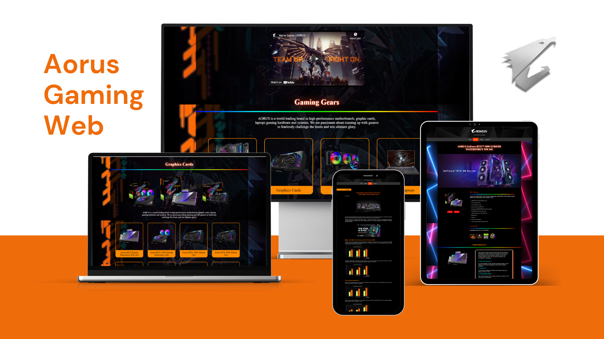

# Aorus Gaming Showcase

[](#)
[](#)
[](#)
[](#)
[](./LICENSE)



**Aorus Gaming Showcase** is an immersive, multimedia-rich hardware catalog and interactive web showcase inspired by GIGABYTE's flagship gaming brand, AORUS. Designed to provide PC gaming enthusiasts, esports players, and custom system builders with an engaging digital showroom, the application organizes high-performance gaming hardware into clean, interactive product categories—spanning motherboards, graphics cards, core system components, and gaming laptops—paired with in-depth technical articles, architectural teardowns, and empirical hardware benchmark analyses.

Traditional hardware catalog sites often present technical specifications as dense, static tables devoid of visual immersion or dynamic context. **Aorus Gaming Showcase** solves this by fusing ambient looping background videos, high-resolution multi-angle product photography, interactive JavaScript-driven image carousels, expandable technical specification accordions, and a client-side real-time digital clock. Additionally, the project features a server-side PHP product registration portal enabling users to register their hardware serial numbers and purchase metadata with immediate tabular receipt confirmation, delivering a cohesive gaming brand experience from product discovery to post-purchase ownership.

---

## Features

- **Multi-Category Hardware Showcase**: Comprehensive product catalog organized across four primary gaming hardware categories—Gaming Laptops (AORUS 15, 17, 5), Graphics Cards (GeForce RTX 3050 up to RTX 3090 Xtreme Waterforce), Motherboards (Intel Z690 AORUS series), and PC Components (AORUS C700 Glass chassis, 360mm Liquid Cooler, 1200W Platinum PSU, Gen4 SSD, and RGB Memory).
- **Deep Technical Specifications & Breakdown**: Dedicated product detail pages featuring multi-angle renders, core clock ratings, power phase designs, cooling architectures (MAX-Covered cooling, Waterforce blocks), and expandable `<details>`/`<summary>` specification sheets.
- **Interactive Image Slideshows & Carousel Controls**: Client-side image carousel engine (`Slide Show.js`) providing smooth forward and backward navigation across product gallery angles with custom previous/next controls.
- **Dynamic Real-Time Digital Clock**: Standalone client-side JavaScript module (`Digital Clock.js`) calculating and rendering day of the week, month, date, year, 12-hour formatted time, and dynamic AM/PM period tags with automated second-by-second updates.
- **Ambient Looping Video Backgrounds**: Integrated HTML5 video backgrounds (`PUNK GAMING.mp4` and `Neon Lights Ran In Polygons.mp4`) with poster image fallbacks, looped playback, and muted audio for an immersive futuristic cyberpunk aesthetic.
- **Hardware Benchmarks & Technology Articles**: Curated tech articles featuring empirical benchmark results (Intel 12th-Gen Core i9/i7/i5 on Z690 chipsets across Cinebench R23, 3DMark Time Spy/Fire Strike, Blender rendering, and game frame rates), DDR5 vs. PCIe 5.0 architectural breakdowns, VisionLINK single-cable connectivity overviews, and gaming chair ergonomic guides.
- **Interactive Server-Side Product Registration**: Dedicated PHP form handler (`Product Registration.php`) processing product type, model name, serial number, purchase date, and purchase region via `POST`, with instant on-page tabular receipt rendering.
- **Smooth "Back to Top" Scroll Navigation**: Client-side window scroll listener (`Back To Top.js`) automatically toggling a fixed floating "Up" button once user scroll depth exceeds 250px.
- **Embedded Media & Community Ecosystem**: Integrated responsive YouTube video players for official trailers and benchmark showcases, accompanied by brand navigation and direct community links across YouTube, Instagram, Twitter/X, and Facebook.

---

## Tech Stack

### Core Architecture
- **Markup**: HTML5 (semantic layout, `<video>` backgrounds, responsive `<iframe>` video players, `<details>` interactive accordions)
- **Styling**: CSS3 (custom dark/cyberpunk aesthetic, CSS Flexbox, multi-column CSS Grid, keyframe animations, smooth scrolling, and media queries)
- **Client-Side Scripting**: Vanilla JavaScript (ES6+) (DOM manipulation, carousel/slideshow controller, scroll position listeners, and real-time clock synchronization)
- **Server-Side Scripting**: PHP (POST request handling, input extraction, and dynamic HTML table generation for product registration)

### Tooling & Assets
- **Version Control**: Git & GitHub
- **Visual Assets & Media**: High-definition hardware renders, brand typography, vector iconography, and H.264/MP4 ambient video loops
- **Embedded Services**: YouTube Embedded Player API

---

## Prerequisites

Before running the project locally, ensure you have the following environments available:

- **Web Browser**: Any modern evergreen browser (Google Chrome, Mozilla Firefox, Microsoft Edge, Safari, or Brave) supporting HTML5 video, CSS Flexbox/Grid, and ES6 JavaScript.
- **PHP Runtime** *(Optional — required only for `Product Registration.php`)*: PHP 7.4 or PHP 8.x CLI installed locally, or a local server environment (such as XAMPP, Laragon, WAMP, or Apache/Nginx).

---

## Installation & Setup

1. **Clone the repository:**
   ```bash
   git clone https://github.com/weztcy/Aorus-Gaming-Showcase.git
   cd "Aorus-Gaming-Showcase"
   ```

2. **Verify repository structure:**
   Ensure all HTML, CSS, JavaScript, and multimedia assets under `gallery/` and `script/` are present. No third-party package dependencies or build compilation steps are required.

---

## Usage / Running the Project

### Option 1: Direct Browser Launch (Static Showcase)

Open `index.html` directly in your file explorer by double-clicking the file, or launch it from your command line:

- **Windows (PowerShell):**
  ```powershell
  Start-Process "index.html"
  ```
- **macOS:**
  ```bash
  open index.html
  ```
- **Linux:**
  ```bash
  xdg-open index.html
  ```

Alternatively, serve the static showcase using Python's built-in HTTP server:
```bash
# Python 3.x
python -m http.server 3000
```
Then navigate to `http://localhost:3000` in your web browser.

---

### Option 2: PHP Built-in Server (Full Showcase & Product Registration)

To enable server-side processing for the Product Registration portal (`mainpage/Product Registration.php`), run the PHP development server from the repository root:

```bash
php -S localhost:8000
```

1. Open `http://localhost:8000` in your browser to explore the full showcase.
2. Navigate to the Product Registration page at `http://localhost:8000/mainpage/Product%20Registration.php`.
3. Fill out the registration form (Product Type, Product Name, Serial Number, Purchase Date, Purchase Region) and click **Submit** to view the dynamic server-rendered registration receipt.

---

## Contributing

Contributions, suggestions, and feedback are welcome. To contribute:

1. Fork the repository on GitHub (`https://github.com/weztcy/Aorus-Gaming-Showcase`).
2. Create a dedicated feature or fix branch (`git checkout -b feature/showcase-enhancement`).
3. Commit your changes with clear, descriptive commit messages.
4. Push your branch to your personal fork (`git push origin feature/showcase-enhancement`).
5. Open a Pull Request targeting the `main` branch of this repository.

---

## License

Please see the [LICENSE](./LICENSE) file for the terms and conditions governing the use, modification, and distribution of this project.

## Author & Contact

**Yohanes Dimas Pratama**

- GitHub: [github.com/weztcy](https://github.com/weztcy)
- Portfolio: [dimaspratama.vercel.app](https://dimaspratama.vercel.app)
- LinkedIn: [linkedin.com/in/yohanes-dimas](https://www.linkedin.com/in/yohanes-dimas)

